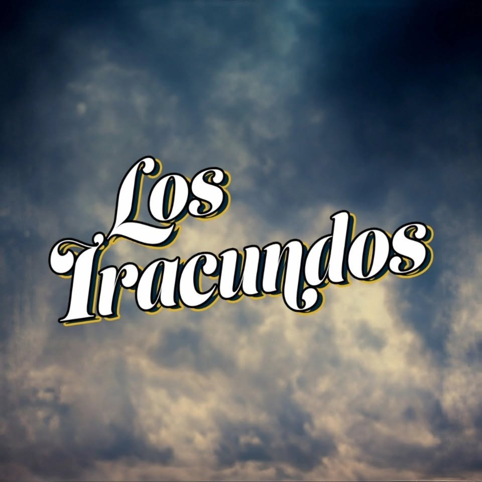
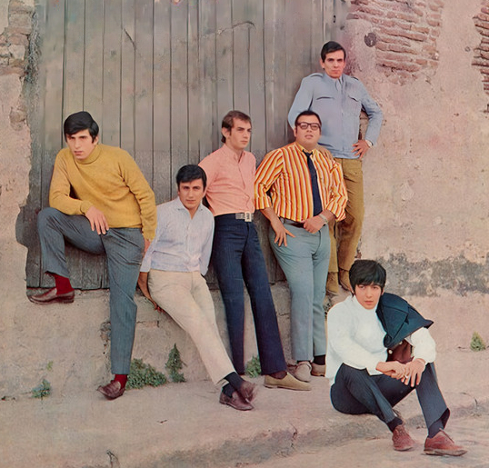
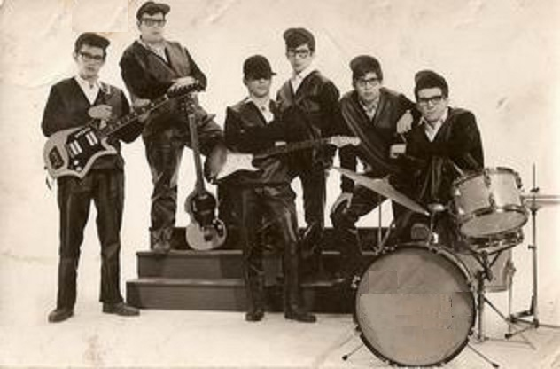
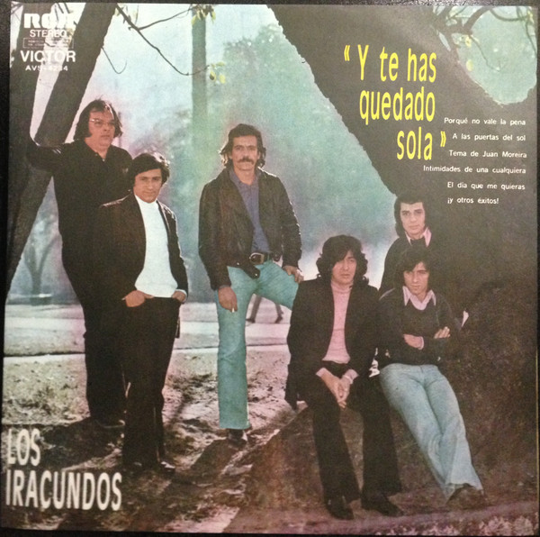
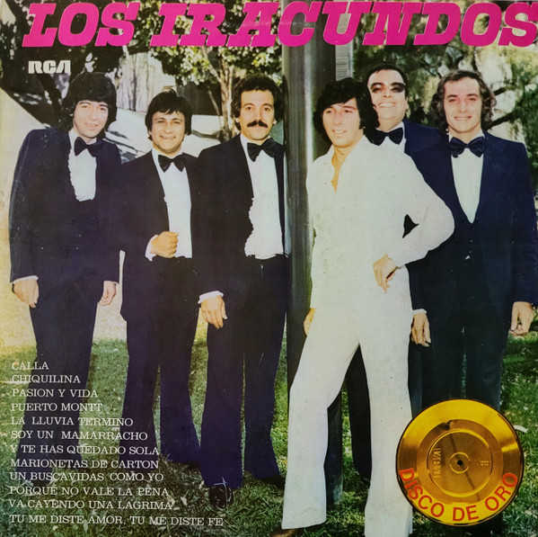
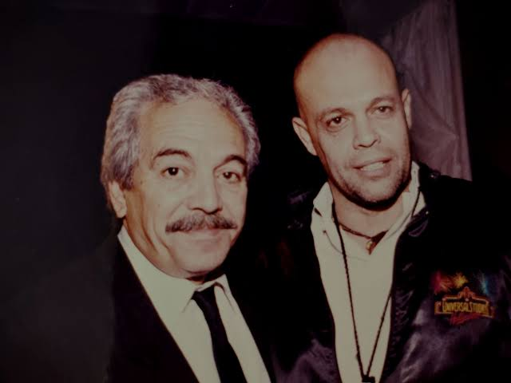

<!DOCTYPE html>
<html lang="es">
<head>
  <meta charset="UTF-8">
  <meta name="viewport" content="width=device-width, initial-scale=1.0">
  <title>Los Iracundos — Legado Musical</title>
  <link rel="stylesheet" href="estilos.css">
</head>
<body>

  

    <!-- ENCABEZADO -->
    <header id="tope-pagina" class="encabezado">
      
      

        <h1>Los Iracundos</h1>
        
Leyendas de la Nueva Ola y la Balada Romántica — Proyecto de Desarrollo de Plataformas Web

      

    </header>

    <!-- MENÚ DE NAVEGACIÓN -->
    <nav class="menu">
      <a href="#inicio">Inicio</a>
      <a href="#biografia">Biografía</a>
      <a href="#galeria">Galería</a>
      <a href="#albumes">Álbumes</a>
      <a href="#conciertos">Conciertos</a>
      <a href="#videos">Videos</a>
      <a href="#audios">Audios MP3</a>
      <a href="#musica">Catálogo</a>
      <a href="#letras">Letras</a>
    </nav>

    <!-- INICIO -->
    <main id="inicio" class="pagina contenido">
      <section class="principal">
        <h2>Bienvenidos</h2>
        
Hola, bienvenido a la página biográfica y musical del grupo uruguayo <strong>Los Iracundos</strong>.

        
Sumérgete en la nostalgia romántica de los años 60 y 70: explora su historia desde Paysandú, su galería fotográfica, sus álbumes en vinilo más emblemáticos, próximas presentaciones, videos, audios en MP3 y las letras que marcaron generaciones.

        

          <a href="#albumes" class="btn-estilo btn-oceano">Explorar álbumes</a>
          <a href="#audios" class="btn-estilo btn-dorado">Escuchar audios MP3</a>
          <a href="#conciertos" class="btn-estilo btn-oceano">Próximos conciertos</a>
        

      </section>

      <aside class="lateral">
        <h3 id="saludo">Ficha del grupo</h3>
        
<strong>Origen:</strong> Paysandú, Uruguay (1958)

        
<strong>Género:</strong> Pop rock / Balada romántica / Nueva ola

        
<strong>Voz inmortal:</strong> Eduardo Franco

        
<strong>Éxito emblemático:</strong> <em>Puerto Montt</em> (1968)

      </aside>
    </main>

    <!-- BIOGRAFÍA -->
    <section id="biografia" class="pagina detalle" hidden>
      <h2>Biografía</h2>

      

        <h3>Nombre artístico</h3>
        
El nombre artístico del grupo es <strong>Los Iracundos</strong>.

      

      

        <h3>Biografía breve</h3>
        

          Los Iracundos es una banda uruguaya de pop rock originaria de Paysandú, considerada en Uruguay la más importante del género. Se originó en 1958 bajo el nombre Los Blue Kings, inspirada en el rock and roll estadounidense de la época, y tuvieron su debut oficial en 1961, año en que lanzaron su primer sencillo con el sello uruguayo Clave. En 1964, firmaron con el sello RCA Victor en Argentina, donde cambiaron su nombre por Los Iracundos y adoptaron su característico estilo melódico y romántico, incorporándose al movimiento de la «nueva ola». La banda tuvo un crecimiento exponencial durante la década de 1960 que los consagraría internacionalmente, con numerosos discos editados, participaciones en películas y giras por América, Europa y Estados Unidos, incluyendo una presentación en el Madison Square Garden de Nueva York. Su mayor éxito vino en 1968 con «Puerto Montt» (Franco/Valdez), la canción más recordada de su carrera. El grupo reafirmó su popularidad en los años 1970 y 1980, editando varios discos de oro. El cantante Eduardo Franco es el autor de casi todo el repertorio compuesto por la banda, que también incluye composiciones instrumentales.
        

      

      

        <h3>País de origen</h3>
        
El país de origen del grupo es Uruguay.

      

      

        <h3>Género musical</h3>
        
El repertorio musical del grupo se basa en géneros como el pop, la canción melódica, la balada romántica, el rock, la nueva ola, la música instrumental y la música beat.

      

      

        <h3>Año de inicio de su carrera</h3>
        
El grupo inició su carrera bajo el nombre de Los Blue Kings entre 1958 hasta el año de 1963, después en 1964 adoptaron el nombre de Los Iracundos, el cual ha sido el nombre de la agrupación hasta el día de hoy.

      

      

        <h3>Fotografía del grupo</h3>
        <figure class="foto-biografia">
          
          <figcaption>Los Iracundos en 1968.</figcaption>
        </figure>
      

      <a class="volver" href="#inicio">← Volver al inicio</a>
    </section>

    <!-- GALERÍA -->
    <section id="galeria" class="pagina detalle" hidden>
      <h2>Galería</h2>
      
Momentos históricos de la trayectoria de Los Iracundos (pasa el cursor sobre cada fotografía):

      

        

          

            
          

          
Los Blue Kings entre 1958 - 1963

        

        

          

            
          

          
Los Iracundos en 1974

        

        

          

            
          

          
Los Iracundos en 1982

        

        

          

            
          

          
Los Iracundos en 1995

        

      

      <a class="volver" href="#inicio">← Volver al inicio</a>
    </section>

    <!-- ÁLBUMES NOTABLES -->
    <section id="albumes" class="pagina detalle" hidden>
      <h2>Álbumes Notables</h2>
      
Los discos LP más emblemáticos y exitosos en la historia de Los Iracundos:

      

        

          

            

          

          1967 • RCA Victor
          <h3>Los Iracundos en Roma</h3>
          
<strong>Temas notables:</strong> <em>Es la lluvia que cae</em>, <em>Sé que no volverás</em>.

        

        

          

            

          

          1968 • RCA Victor
          <h3>Los Iracundos</h3>
          
<strong>Temas notables:</strong> <em>Puerto Montt</em>, <em>Solamente tú</em>.

        

        

          

            

          

          1971 • RCA Victor
          <h3>Agua con amor</h3>
          
<strong>Temas notables:</strong> <em>Agua con amor</em>, <em>Un día distinto</em>.

        

        

          

            

          

          1973 • RCA Victor
          <h3>Te lo pido de rodillas</h3>
          
<strong>Temas notables:</strong> <em>Te lo pido de rodillas</em>, <em>Alguien que se cruce en mi camino</em>.

        

        

          

            

          

          1980 • RCA Victor
          <h3>Incomparables</h3>
          
<strong>Temas notables:</strong> <em>Préstame un te quiero</em>, <em>Miró el teléfono</em>.

        

        

          

            

          

          1984 • RCA Victor
          <h3>Tú con él</h3>
          
<strong>Temas notables:</strong> <em>Tú con él</em>, <em>Las puertas del olvido</em>.

        

      

      <a class="volver" href="#inicio">← Volver al inicio</a>
    </section>

    <!-- PRÓXIMOS CONCIERTOS Y PRESENTACIONES -->
    <section id="conciertos" class="pagina detalle" hidden>
      <h2>Próximos Conciertos y Presentaciones</h2>
      
Fechas confirmadas de sus presentaciones:

      

        

          

            13 - 15
            Nov 2026
          

          

            <h3>Uruguay</h3>
            
Se presentan hoy 13 de noviembre en el <strong>Teatro Florencio Sánchez de Paysandú</strong> conmemorando el 85.º aniversario del natalicio de Juano Velázquez, seguidos por conciertos en <strong>Rocha</strong> el 14 y en la <strong>Sala Cantegril de Punta del Este</strong> el 15.

          

          En curso
        

        

          

            21
            Nov 2026
          

          

            <h3>Argentina</h3>
            
Tienen programada una presentación en la ciudad de <strong>Gualeguay</strong>.

          

          Confirmado
        

        

          

            25 - 29
            Nov 2026
          

          

            <h3>Perú</h3>
            
Realizarán la gira <em>Leyendas del Romanticismo</em> junto a <strong>Germaín de la Fuente</strong> y <strong>Los Dolton's</strong> visitando <strong>Huancayo, Moyobamba, Iquitos, Cajamarca y Lima</strong>.

          

          Gira confirmada
        

        

          

            2 - 6
            Dic 2026
          

          

            <h3>Centroamérica</h3>
            
Llevarán su gira por <strong>Ciudad de Guatemala</strong> (2 de diciembre), <strong>San Salvador</strong> (3 de diciembre), <strong>San Pedro Sula</strong> (4 de diciembre), <strong>Tegucigalpa</strong> (5 de diciembre) y <strong>Ciudad de Panamá</strong> (6 de diciembre).

          

          Próximamente
        

        

          

            20
            Dic 2026
          

          

            <h3>Paraguay</h3>
            
Realizarán una presentación de carácter privado.

          

          Evento privado
        

        

          

            21
            Dic 2026
          

          

            <h3>Argentina</h3>
            
Ofrecerán un concierto en la ciudad de <strong>Posadas</strong>.

          

          Confirmado
        

      

      <a class="volver" href="#inicio">← Volver al inicio</a>
    </section>

    <!-- AUDIOS MP3 -->
    <section id="audios" class="pagina detalle" hidden>
      <h2>Audios en MP3</h2>
      
Selecciona una canción de la lista para ir directamente a su reproductor o navega entre pistas:

      

        Ir a la canción:
        <a href="#pista-fabula">1. Fábula</a>
        <a href="#pista-te-lo-pido">2. Te lo pido de rodillas</a>
        <a href="#pista-puerto-montt">3. Puerto Montt</a>
      

      

        

          <strong>1. Fábula (1979)</strong>
          
Álbum: <em>Fábula (1979)</em>

          <audio controls preload="none">
            <source src="fábula.mp3" type="audio/mpeg">
            Tu navegador no soporta la reproducción de audio HTML5.
          </audio>
          

            <a href="#letra-fabula">Leer letra</a>
            <a href="#pista-te-lo-pido">Siguiente canción ↓</a>
          

        

        

          <strong>2. Te lo pido de rodillas (1970)</strong>
          
Álbum: <em>Te lo pido de rodillas (1973)</em>

          <audio controls preload="none">
            <source src="te_lo_pido_de_rodillas.mp3" type="audio/mpeg">
            Tu navegador no soporta la reproducción de audio HTML5.
          </audio>
          

            <a href="#pista-fabula">↑ Anterior</a>
            <a href="#letra-te-lo-pido">Leer letra</a>
            <a href="#pista-puerto-montt">Siguiente canción ↓</a>
          

        

        

          <strong>3. Puerto Montt (1968)</strong>
          
Álbum: <em>Los Iracundos (1968)</em>

          <audio controls preload="none">
            <source src="puerto_montt.mp3" type="audio/mpeg">
            Tu navegador no soporta la reproducción de audio HTML5.
          </audio>
          

            <a href="#pista-te-lo-pido">↑ Anterior</a>
            <a href="#letra-puerto-montt">Leer letra</a>
          

        

      

      <a class="volver" href="#inicio">← Volver al inicio</a>
    </section>

    <!-- CATÁLOGO DE CANCIONES (SOLO LAS 3 CANCIONES ORIGINALES) -->
    <section id="musica" class="pagina detalle" hidden>
      <h2>Música — Catálogo musical y discografía</h2>
      <ul class="lista-items">
        <li>
          <strong>Fábula</strong> (1979) — Álbum: <em>Incomparables (1980)</em>
          

            <a href="#pista-fabula">Escuchar MP3</a>
            <a href="#letra-fabula">Ver letra con audio</a>
          

        </li>
        <li>
          <strong>Te lo pido de rodillas</strong> (1973) — Álbum: <em>Te lo pido de rodillas (1973)</em>
          

            <a href="#pista-te-lo-pido">Escuchar MP3</a>
            <a href="#letra-te-lo-pido">Ver letra con audio</a>
          

        </li>
        <li>
          <strong>Puerto Montt</strong> (1968) — Álbum: <em>Los Iracundos (1968)</em>
          

            <a href="#pista-puerto-montt">Escuchar MP3</a>
            <a href="#letra-puerto-montt">Ver letra con audio</a>
          

        </li>
      </ul>

      <a class="volver" href="#inicio">← Volver al inicio</a>
    </section>

    <!-- VIDEOS -->
    <section id="videos" class="pagina detalle" hidden>
      <h2>Videos</h2>
      <ul class="lista-items">
        <li>
          <strong>Los Iracundos Viejitas Romanticas – Grandes Clásicos Románticos</strong>
          

            <iframe src="https://www.youtube.com/watch?v=u9iF2FCK_iY" title="Los Iracundos Viejitas Romanticas – Grandes Clásicos Románticos" allow="accelerometer; autoplay; clipboard-write; encrypted-media; gyroscope; picture-in-picture; web-share" referrerpolicy="strict-origin-when-cross-origin" allowfullscreen></iframe>
          

          <a class="enlace-respaldo" href="https://www.youtube.com/watch?v=u9iF2FCK_iY" target="_blank" rel="noopener noreferrer">Ver en YouTube</a>
        </li>
      </ul>

      <a class="volver" href="#inicio">← Volver al inicio</a>
    </section>

    <!-- LETRAS DE CANCIONES -->
    <section id="letras" class="pagina detalle" hidden>
      <h2>Letras de canciones</h2>
      
Reproduce la pista asociada a cada canción y consulta su reseña, fragmento destacado y enlace a la letra completa:

      

        Saltar a la canción:
        <a href="#letra-fabula">1. Fábula</a>
        <a href="#letra-te-lo-pido">2. Te lo pido de rodillas</a>
        <a href="#letra-puerto-montt">3. Puerto Montt</a>
      

      <!-- Canción 1: Fábula -->
      

        

          

            <h3>1. Fábula</h3>
            Álbum: <em>Incomparables</em> (1980)
          

          <a href="#musica" class="btn-catalogo">← Regresar al catálogo musical</a>
        

        

          Escuchar canción mientras lees:
          <audio controls preload="none">
            <source src="fábula.mp3" type="audio/mpeg">
            Tu navegador no soporta la reproducción de audio HTML5.
          </audio>
        

        

          
<strong>Sobre la canción:</strong> Balada melancólica sobre la soledad tras el abandono y la espera constante por un amor que se perdió en la vida nocturna, comparando esa ilusión con una fábula.

          

            <em>«Fábula, de un pobre tonto que siempre te amó 
            Y que sus puertas nunca más cerró 
            Con la esperanza de volverte a ver.»</em> — <strong>Los Iracundos</strong>
          

          
Encuentra la letra completa buscando <a href="https://www.google.com/search?q=Fabula+Los+Iracundos+letra" target="_blank" rel="noopener noreferrer">«Fábula Los Iracundos letra» en Google</a>.

        

        

          <a href="#musica">← Catálogo musical</a>
          <a href="#letra-te-lo-pido">Siguiente letra: Te lo pido de rodillas ↓</a>
        

      

      <!-- Canción 2: Te lo pido de rodillas -->
      

        

          

            <h3>2. Te lo pido de rodillas</h3>
            Álbum: <em>Te lo pido de rodillas</em> (1973)
          

          <a href="#musica" class="btn-catalogo">← Regresar al catálogo musical</a>
        

        

          Escuchar canción mientras lees:
          <audio controls preload="none">
            <source src="te_lo_pido_de_rodillas.mp3" type="audio/mpeg">
            Tu navegador no soporta la reproducción de audio HTML5.
          </audio>
        

        

          
<strong>Sobre la canción:</strong> Súplica romántica que retrata la llamada tras un año de distanciamiento para pedir una segunda oportunidad y reavivar el vínculo amoroso.

          

            <em>«Voy a pedirte de rodillas que regreses junto a mí 
            Porque soy de ti 
            Y te quiero como antes, mucho más.»</em> — <strong>Los Iracundos</strong>
          

          
Encuentra la letra completa buscando <a href="https://www.google.com/search?q=Te+lo+pido+de+rodillas+Los+Iracundos+letra" target="_blank" rel="noopener noreferrer">«Te lo pido de rodillas Los Iracundos letra» en Google</a>.

        

        

          <a href="#letra-fabula">↑ Anterior: Fábula</a>
          <a href="#musica">← Catálogo musical</a>
          <a href="#letra-puerto-montt">Siguiente letra: Puerto Montt ↓</a>
        

      

      <!-- Canción 3: Puerto Montt -->
      

        

          

            <h3>3. Puerto Montt</h3>
            Álbum: <em>Los Iracundos</em> (1968)
          

          <a href="#musica" class="btn-catalogo">← Regresar al catálogo musical</a>
        

        

          Escuchar canción mientras lees:
          <audio controls preload="none">
            <source src="puerto_montt.mp3" type="audio/mpeg">
            Tu navegador no soporta la reproducción de audio HTML5.
          </audio>
        

        

          
<strong>Sobre la canción:</strong> El mayor éxito internacional del grupo, inspirado en la ciudad portuaria del sur de Chile, que evoca la nostalgia y el arrepentimiento tras una despedida frente al mar.

          

            <em>«Puerto Montt, Puerto Montt 
            Me alejé de ti 
            Sin saber por qué 
            Y yo la dejé sola frente al mar»</em> — <strong>Los Iracundos</strong>
          

          
Encuentra la letra completa buscando <a href="https://www.google.com/search?q=Puerto+Montt+Los+Iracundos+letra" target="_blank" rel="noopener noreferrer">«Puerto Montt Los Iracundos letra» en Google</a>.

        

        

          <a href="#letra-te-lo-pido">↑ Anterior: Te lo pido de rodillas</a>
          <a href="#musica">← Regresar al catálogo musical</a>
        

      

      <a class="volver" href="#inicio">← Volver al inicio</a>
    </section>

    <!-- PIE DE PÁGINA -->
    <footer class="pie">
      

        Redes oficiales de Los Iracundos:
        <a href="https://www.facebook.com/losiracundosoriginales/" target="_blank" rel="noopener noreferrer">Facebook</a>
        <a href="https://www.instagram.com/losiracundosoriginales" target="_blank" rel="noopener noreferrer">Instagram</a>
        <a href="https://losiracundos.com/" target="_blank" rel="noopener noreferrer">Sitio web</a>
        <a href="https://www.tiktok.com/@losiracundosoriginales" target="_blank" rel="noopener noreferrer">TikTok</a>
        <a href="https://x.com/Los_Iracundos" target="_blank" rel="noopener noreferrer">X</a>
        <a href="https://www.youtube.com/@LosIracundosOriginales" target="_blank" rel="noopener noreferrer">YouTube</a>
      

      

        Hecho por Randy Daves De Santis Cruz - Carrera de Sistemas de Información 3er Semestre "C" Vespertino - Creado en el año 2026 - Comentarios y sugerencias al correo:
        <a href="mailto:randydavesdesantiscruz1996@gmail.com">randydavesdesantiscruz1996@gmail.com</a> - Todos los derechos reservados
      

    </footer>

  

  <!-- BOTÓN FLOTANTE PARA REGRESAR AL INICIO DE LA PÁGINA -->
  <button id="btn-subir" type="button" title="Regresar al inicio de la página">↑ Inicio</button>

  

</body>
</html>2
